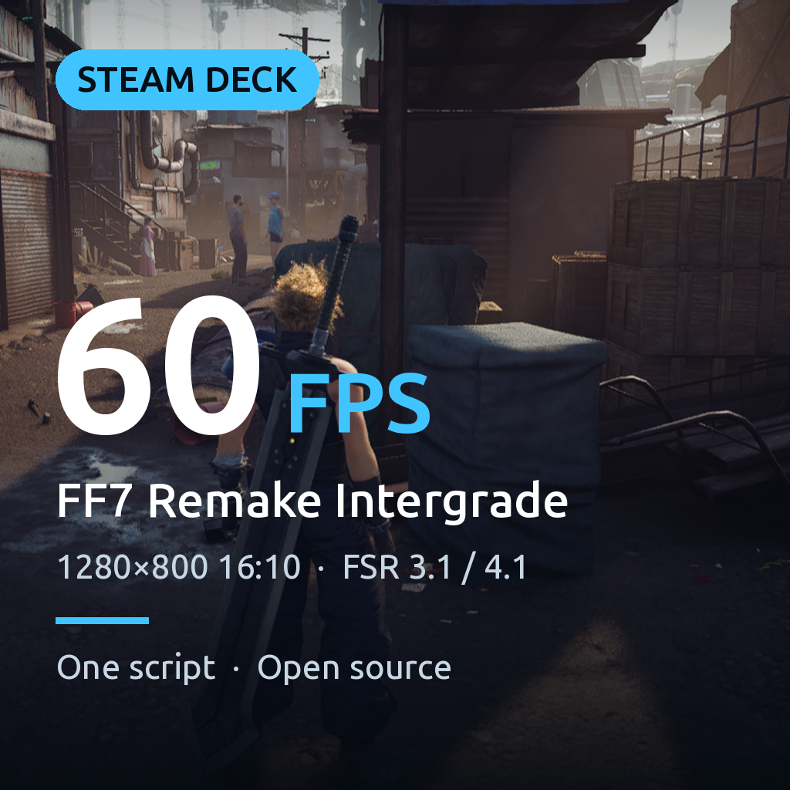

# Final Fantasy VII Remake Intergrade on Steam Deck: 60 fps with FSR upscaling



FF7 Remake Intergrade runs badly on the Steam Deck. This sets it up to run at **~60 fps at the Deck's full 1280x800 (16:10)**, or at a
sharper 40 fps with **FSR 4.1** (AMD's new INT8 "Lite" model made for handhelds), using open source mods and one install script.

Measured on a Steam Deck LCD (Proton 11, Chapter 3 Sector 7 Slums alley, frame rate uncapped, 30 s standing still):

| Setup | Average fps | 1% low |
|---|---:|---:|
| Full resolution (1280x720, no upscaling, default settings) | 23.5 | |
| **This guide, 60 preset**: FSR 3.1 at 58% render scale, tuned settings | **64.3** | 48.7 |
| **This guide, 40 preset**: FSR 4.1 INT8 Lite at 67%, tuned settings | 55.7 | 40.8 |

Combat and big areas are heavier than the alley, so the 60 preset dips into the 40s there; the 40 preset holds a 40 fps cap.
The first hour stutters more, while DXVK compiles the game's shaders.

## Why the game runs badly, and what this does

- The game's own dynamic resolution only runs in DX12. Under DX11 (needed by the mods) it renders at full resolution, which the Deck can't hold.
- [**Luma**](https://github.com/Filoppi/Luma-Framework) for FF7R replaces the game's TAA with FSR (and fixes HDR, tonemapping and more). This guide uses a
  [patched build](https://github.com/wiggyoats/Luma-Framework/tree/ff7r-fixed-scale-upscaling) of it: the official one only upscales when the game's
  dynamic resolution is running, otherwise FSR just anti-aliases a low resolution image that the game then stretches. The patch makes FSR truly
  upscale with a fixed render scale (`r.ScreenPercentage`), and runs the post processing at full resolution.
- [**OptiScaler**](https://github.com/optiscaler/OptiScaler) unlocks FSR 4.1 under Proton on the Deck's GPU (AMD's DLL only offers FSR 3 there) and
  selects the INT8 Lite model.
- [**FF7RemakeFix**](https://codeberg.org/Lyall/FF7RemakeFix) by Lyall renders at 16:10 instead of letterboxing to 16:9 (HUD stays 16:9).
- [**FFVIIHook**](https://www.nexusmods.com/finalfantasy7remake/mods/74) by emoose makes the game read `Engine.ini`, where the render scale and the
  settings below go.
- A few engine settings, chosen by benchmarking every candidate on the Deck, cost a lot for little visible difference at 800p:

  | Engine.ini setting | fps gained | Visible difference |
  |---|---:|---|
  | `r.Shadow.MaxCSMResolution=1024`, `r.Shadow.CSM.MaxCascades=2` | +15 | Shadows pop in a bit in big areas |
  | `r.VolumetricFog.GridPixelSize=16`, `GridSizeZ=32`, `HistoryMissSupersampleCount=1` | +4 | None noticed (turning fog off: +6, but looks flat) |
  | `r.TranslucencyLightingVolumeDim=24` | +4 | None noticed |

  Motion blur, ambient occlusion, reflections, material quality, view distance and detail mode were also tested: turning them down gains nothing.

## Install

You need: the game from Steam, played once without mods (so its Proton prefix exists), and a Nexus Mods account (free) for FFVIIHook.

1. Switch to **Desktop Mode** (Steam button > Power > Switch to Desktop).
2. Download **FFVIIHook** from [Nexus Mods](https://www.nexusmods.com/finalfantasy7remake/mods/74) and put its `xinput1_3.dll` into
   `FINAL FANTASY VII REMAKE/End/Binaries/Win64` (in Steam: right click the game > Manage > Browse local files).
3. Open Konsole and run:

   ```bash
   curl -fLO https://raw.githubusercontent.com/wiggyoats/ff7r-steamdeck/main/install.sh
   bash install.sh
   ```

   For the sharper 40 fps preset: `bash install.sh --preset 40`. To change the render scale: `--scale 50` (50 to 100).
4. In Steam, right click the game > Properties > **Launch Options**:

   ```
   WINEDLLOVERRIDES="xinput1_3,dsound,dxgi=n,b" %COMMAND% -dx11
   ```
5. Start the game. In Graphics settings, pick the resolution that used to say **3840x2160** (it is now 1280x800) and frame rate **60**.
6. 40 preset only: in the quick access menu (••• button) > Performance, set **Refresh Rate 40** and **Frame Limit 40**.

The script finds the game on internal storage or SD card, backs up the files it replaces to `~/ff7r-deck-backup`, downloads the mods
(checksum verified), writes the settings, and installs the Visual C++ runtime the mod needs into the game's prefix.

To uninstall: `bash install.sh --uninstall`, then clear the launch options.

## Troubleshooting

- **The game closes on start, or Luma shows an error about a missing or old Visual C++ runtime:** the runtime install into the prefix failed.
  Run the script again.
- **It still looks blurry / the fps didn't change:** FFVIIHook isn't loaded (check `xinput1_3.dll` is next to `ff7remake_.exe` and the launch options),
  so the game ignores `Engine.ini`.
- **Black bars:** you picked 1280x720 instead of the resolution that replaced 3840x2160.
- **Settings menu for the mods:** press the ReShade key (Home, or bind one with Steam Input) for Luma's menu, Insert for OptiScaler's.

## Credits

- Luma for FF7R: Izueh and Pumbo, [Luma Framework](https://github.com/Filoppi/Luma-Framework) (custom MIT license). Patch in this build: this repo's author.
- [OptiScaler](https://github.com/optiscaler/OptiScaler) team (GPL-3.0).
- AMD FidelityFX Super Resolution 3.1 / 4.1 (AMD FidelityFX license, shipped with Luma).
- [FF7RemakeFix](https://codeberg.org/Lyall/FF7RemakeFix) by Lyall.
- [FFVIIHook](https://www.nexusmods.com/finalfantasy7remake/mods/74) by emoose.

None of these projects is affiliated with this guide; please report problems here, not to them. The script is MIT licensed (see `LICENSE`).
